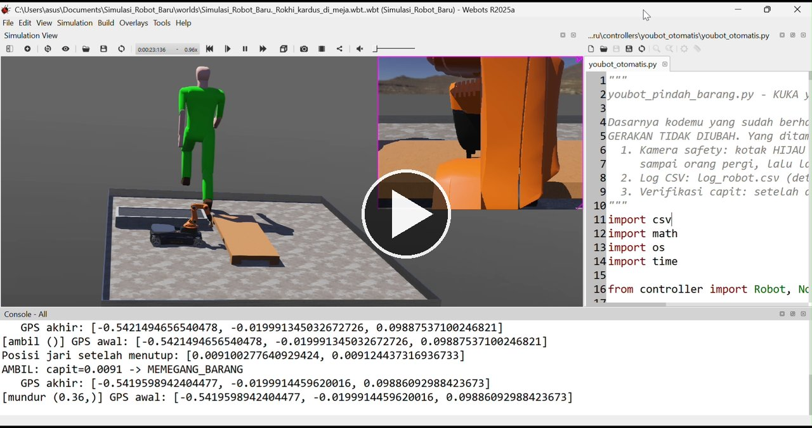
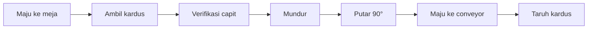
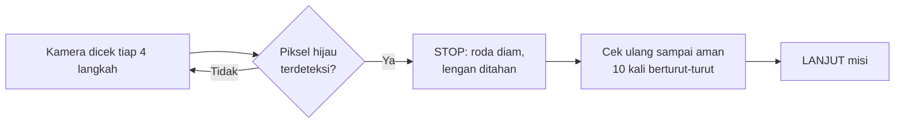

<div align="center">

# 🤖 KUKA youBot: Pick & Place dengan Kamera Safety

**Robot memindahkan kardus dari meja ke conveyor, dan berhenti otomatis saat ada orang mendekat.**


[](https://drive.google.com/file/d/1n_nHenwsnUxVP6ScQ3cE24JSVgJJzaUV/view?usp=drivesdk)

▶️ [**Tonton video demo (±70 detik)**](https://drive.google.com/file/d/1n_nHenwsnUxVP6ScQ3cE24JSVgJJzaUV/view?usp=drivesdk) · 💼 [Postingan LinkedIn](GANTI_DENGAN_LINK_POSTINGAN_LINKEDIN)

</div>

---

## ✨ Sekilas

Ini proyek pertama saya di robotika, dibuat di simulator **Webots**. Robot **KUKA youBot** menjalankan satu siklus kerja lengkap tanpa dikendalikan manual:

| | |
|---|---|
| 📦 **Tugas** | Ambil kardus di meja, pindahkan ke conveyor |
| 🧍 **Safety** | Kamera pengawas mendeteksi orang, robot berhenti total, lalu lanjut sendiri saat area aman |
| ✅ **Verifikasi** | Posisi capit dibaca untuk memastikan kardus benar-benar terjepit |
| 📝 **Log** | Setiap langkah dan setiap siklus dicatat ke file CSV |

Idenya terinspirasi dari kerja di lantai produksi: kerja otomatis itu harus aman dan hasilnya harus bisa diperiksa.

## 🇬🇧 English summary

A beginner robotics project built in **Webots**. A **KUKA youBot** picks up a cardboard box from a table, places it on a conveyor, and **stops automatically** when a safety camera detects a person, then resumes when the area is clear.

- **Sensors:** GPS and IMU for positioning and turning, a camera for person detection, and gripper position feedback to verify the grasp.
- **Logging:** every step and every cycle is recorded to CSV files.
- **What I learned:** positioning with coordinates, matching object and table height to the arm's reach, and tuning the gripper opening and sensor threshold by measuring readings with and without the box.
- **Limitations:** simulation only; person detection is color-based (green), not real human recognition.

The controller code was written with AI assistance (Claude); I ran, tested, measured, and tuned it myself.

## 🎬 Alur kerja



Safety berjalan **sepanjang misi**, di setiap langkah:



## 🧰 Perangkat di robot dan simulasi

| Komponen | Fungsi |
|---|---|
| GPS | Mengukur jarak tempuh dan menentukan titik berhenti |
| InertialUnit (IMU) | Mengukur sudut putar robot |
| Kamera `CCTV_PABRIK` | Safety: mendeteksi orang |
| Pedestrian (Webots) | "Orang" yang berjalan melintas di sekitar robot (kecepatan 0.4) |
| Sensor posisi motor | Membaca posisi lengan dan jari capit |

### Parameter penting

| Parameter | Nilai | Keterangan |
|---|---|---|
| `LEBAR_BARANG` | 0.04 m | Ukuran kardus |
| `BUKA_CAPIT` | 0.024 m | Bukaan maksimum tiap jari |
| `GRIP_MIN_TERISI` | 0.0085 | Ambang verifikasi capit |
| `AMBANG_ORANG` | 0.015 | Rasio piksel hijau minimal untuk dianggap orang |
| `CEK_KAMERA_SETIAP` | 4 langkah | Seberapa sering kamera dicek |
| `AMAN_BERTURUT` | 10 cek | Syarat lanjut setelah STOP |

## 📊 Hasil

<!-- Ganti angka di bawah jika kamu menjalankan ulang dan hasilnya berbeda. -->

- **Misi selesai** sampai tahap taruh, dan console mencetak `Misi selesai.`.
- **Safety bekerja.** Di video demo robot berhenti dan lanjut otomatis beberapa kali, misalnya sekitar detik 1,8 sampai 3,2 (saat awal), detik 35 sampai 43 (saat memutar sambil membawa kardus), dan detik 61 sampai 63 (saat menaruh).
- **Verifikasi capit:** jari menutup ke **0.0091** saat memegang kardus dan **0.0080** saat kosong. Selisihnya hanya sekitar 1 mm, jadi ambang ditetapkan di antaranya (**0.0085**). Console mencetak `AMBIL: capit=0.0091 -> MEMEGANG_BARANG`.

## 🧗 Kendala dan pelajaran

- **Koordinat.** Menentukan titik berhenti robot di depan meja dan conveyor memakai GPS sampai posisi capit pas.
- **Tinggi objek.** Menyesuaikan tinggi meja dan kardus dengan jangkauan lengan robot, termasuk pose lengan saat turun dan angkat.
- **Lebar gripper.** Menyesuaikan bukaan capit dan ambang sensor dengan ukuran kardus. Ambang awal yang saya hitung dari lebar kardus ternyata salah karena asumsi geometri gripper tidak cocok dengan model di simulasi. Saya koreksi dengan **mengukur bacaan capit dengan dan tanpa kardus**.
- **Kamera dan Pedestrian.** Mengatur `translation` dan `rotation` kamera dan Pedestrian supaya gerakan terlihat jelas, dan menyetel ambang deteksi supaya robot tidak berhenti terlalu sering.
- **Kebiasaan menguji.** Mengubah satu hal per percobaan dan mencatat hasilnya. Cara kerja ini saya bawa dari pengalaman di quality control.

## ⚠️ Keterbatasan

- Semua hasil berasal dari simulasi, bukan robot fisik.
- Deteksi "orang" masih berbasis warna hijau, bukan pengenalan manusia yang sebenarnya.
- Keberhasilan pengambilan dinilai dari sensor capit, bukan dari verifikasi posisi kardus di conveyor.
- Kardus yang ditaruh di conveyor ikut terbawa bergerak ke pinggir, sehingga lama-lama keluar dari pandangan kamera.

## 🚀 Cara menjalankan

1. Pasang **Webots R2025a**.
2. Salin folder `controllers` dan `worlds` ke proyek Webots.
3. Buka file world, pastikan controller robot `youbot_otomatis` dan controller Pedestrian `pedestrian`.
4. Simpan kode (Ctrl+S), reset simulasi, lalu tekan play. File log tersimpan di folder controller.

## 📁 Struktur repository

```
├── controllers/youbot_otomatis/youbot_otomatis.py   # program utama robot
├── worlds/<nama-world>.wbt                           # dunia simulasi
├── data/log_robot.csv, ringkasan_siklus.csv          # contoh hasil log
├── demo-thumbnail.jpg                                # gambar sampul video
└── README.md
```

## 🗺️ Rencana berikutnya

- [ ] Hentikan misi otomatis jika capit kosong
- [ ] Analisis `ringkasan_siklus.csv` dengan pandas (grafik durasi dan jumlah STOP)
- [ ] Deteksi orang yang lebih baik dari sekadar warna

## 📝 Catatan

Kode controller dibuat dengan bantuan AI (Claude). Saya menjalankan, menguji, mengukur, dan menyesuaikan parameternya sendiri di simulasi.

## 👤 Tentang saya

**Rokhibul Ulum.** Latar belakang di engineering workshop (membuat tool, die, dan jig untuk mesin assembly dan stamping), operator produksi, dan operator quality control. Sedang belajar robotika dan data science.
